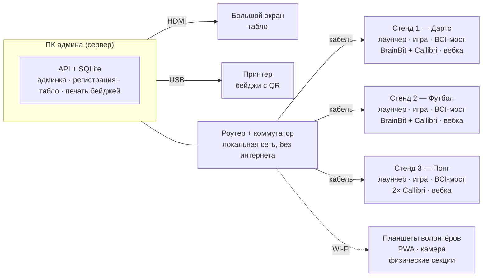
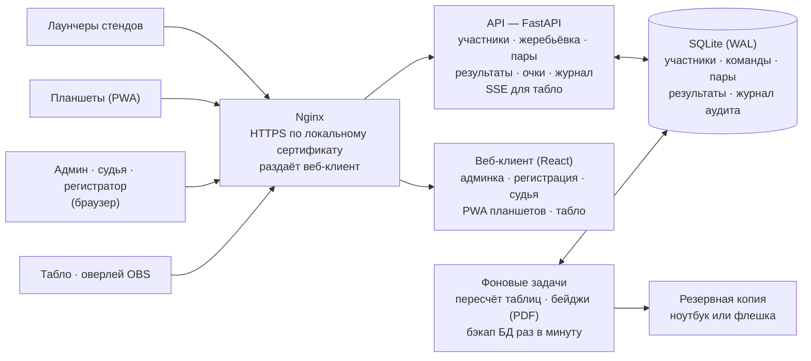
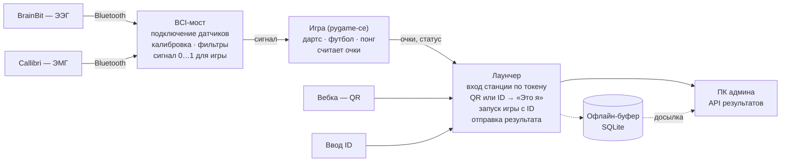
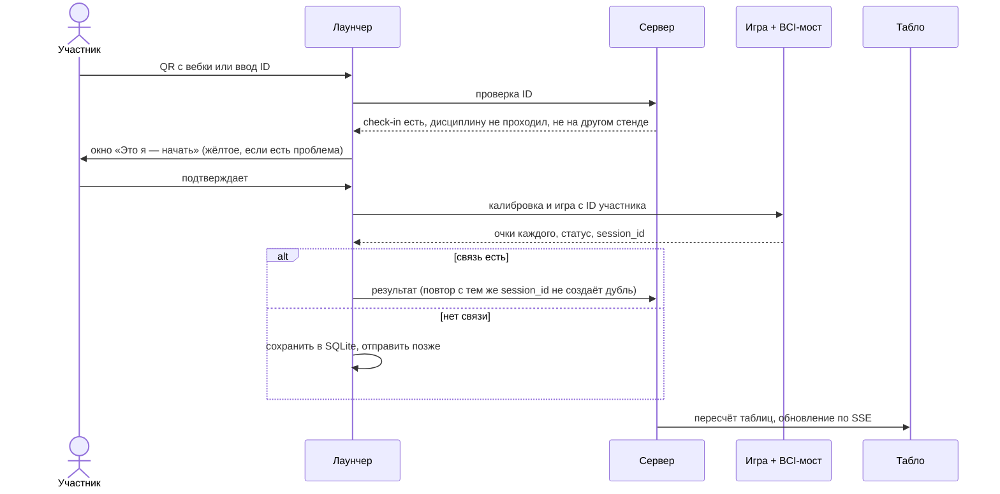
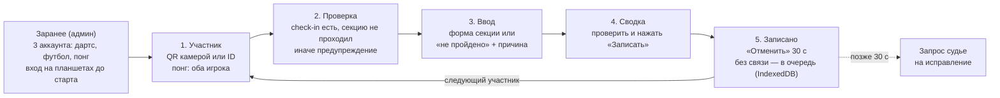
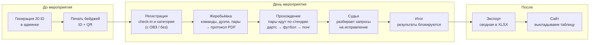
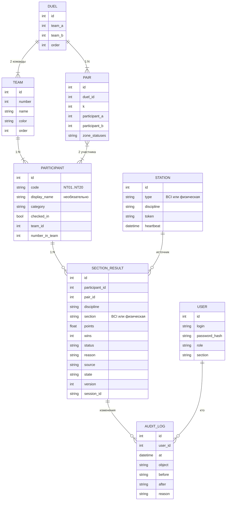
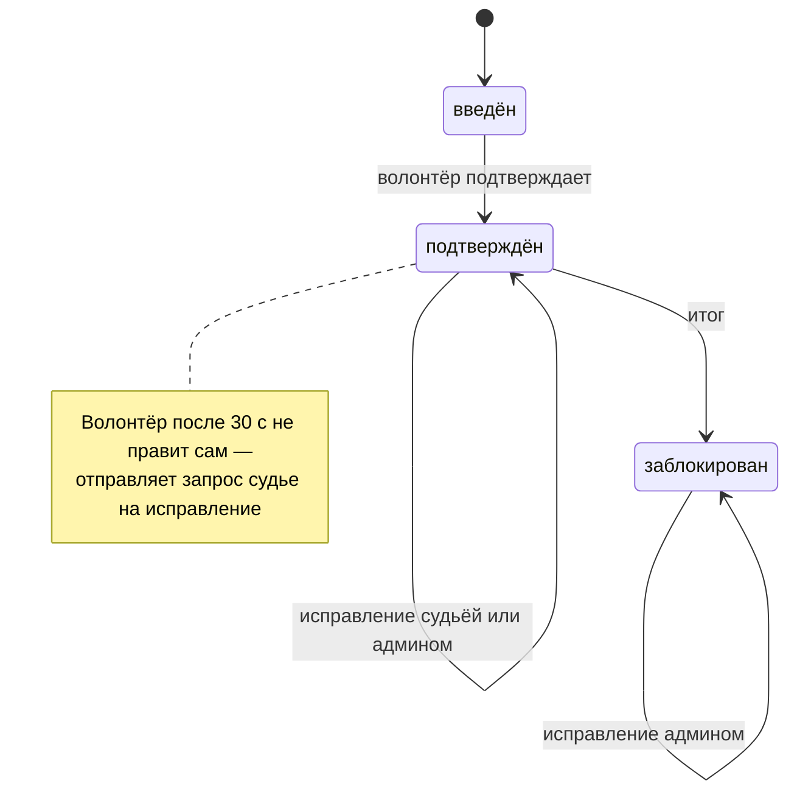
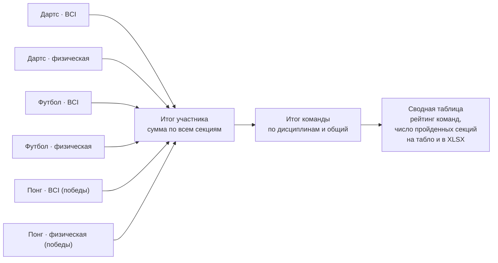

# Архитектура системы «Нейротлон»

Система проведения мероприятия в зале. Работает в локальной сети без интернета.
Сайт мероприятия — отдельный проект; итоговая таблица выкладывается на него после мероприятия вручную.

Схемы — источник истины. Меняются через PR вместе с кодом.

## 1. Физическая схема зала

- Без связи стенд копит результаты в локальном SQLite и досылает их позже.
- Вход участника: QR с вебки или ручной ввод ID → окно «Это я».
- Камера в браузере планшета работает только по HTTPS → локальный корневой сертификат на каждом планшете.

## 2. Сервисы на ПК админа

- SQLite в режиме WAL, `busy_timeout`, пишет один серверный процесс. Доступ через SQLAlchemy + Alembic — переход на PostgreSQL при росте сводится к смене строки подключения.
- Бэкап — `VACUUM INTO` / Backup API раз в минуту на внешний носитель или второй ноутбук.
- После мероприятия: экспорт сводной таблицы в XLSX → публикация на сайте.

## 3. Устройство стенда

- BCI-мост — отдельный процесс на стенде; игра получает от него нормализованный сигнал по локальному сокету и не зависит от SDK датчиков. Для разработки без датчиков — эмуляция с клавиатуры.
- Понг: на одном ПК два Callibri (только ЭМГ), двое игроков.

## 4. Участник на стенде

Сервер ничего не назначает — только проверяет. Понг: сканируются оба игрока, результат — победитель и очки каждого.

## 5. Планшет волонтёра

- Аккаунт волонтёра привязан к одной секции; сессия не истекает в течение дня; суперпользователь может завершить сессии аккаунта.
- Формы: дартс — броски; полоса — 4 элемента и точность; понг — победитель и очки каждого.

## 6. Жизненный цикл

## 7. Модель данных

- Итоги (участника, команды, рейтинг, исход дуэли) не хранятся — вычисляются из `SECTION_RESULT`.
- Журнал аудита только на добавление (триггеры запрещают UPDATE/DELETE).

## 8. Статусы результата

## 9. Расчёт очков

- Равенство: больше пройденных секций → больше BCI-очков → больше физических → решение судьи.
- Шкалы и формулы секций — в настройках, без правки кода. Время не влияет. Методика подсчёта внутри игр — отдельный документ (в работе).
