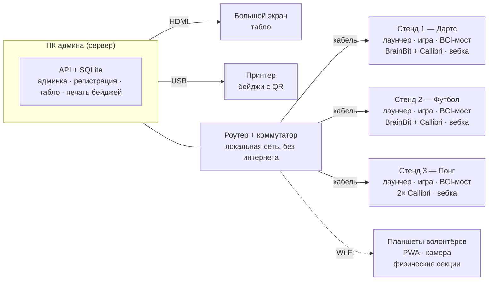
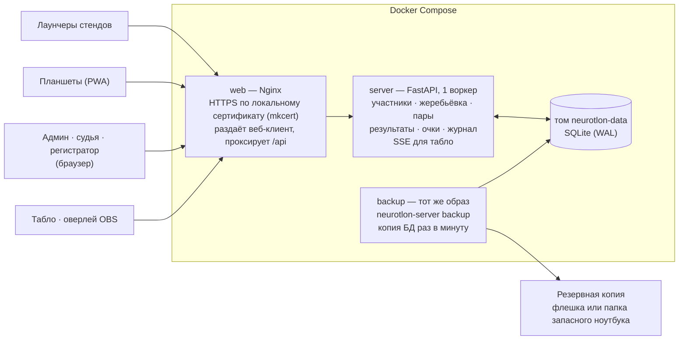
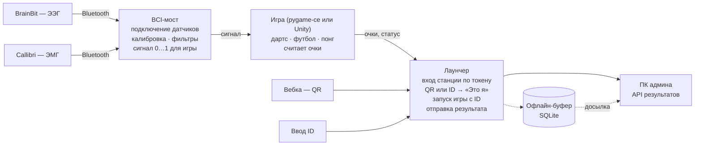
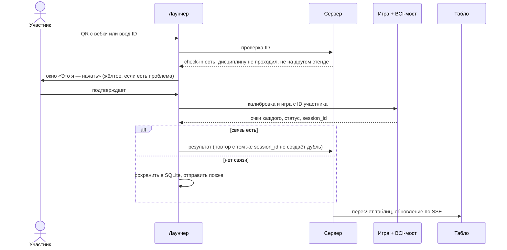
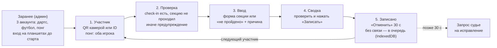
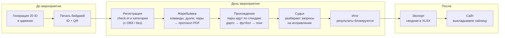
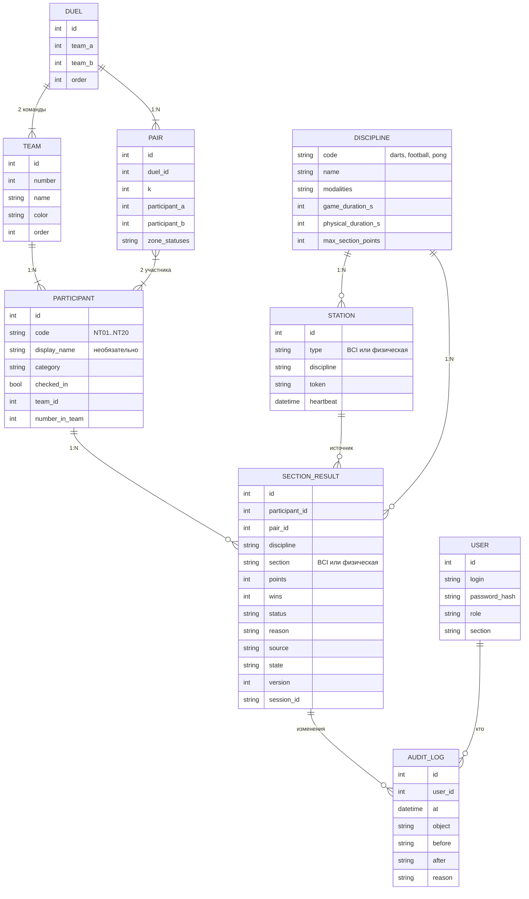
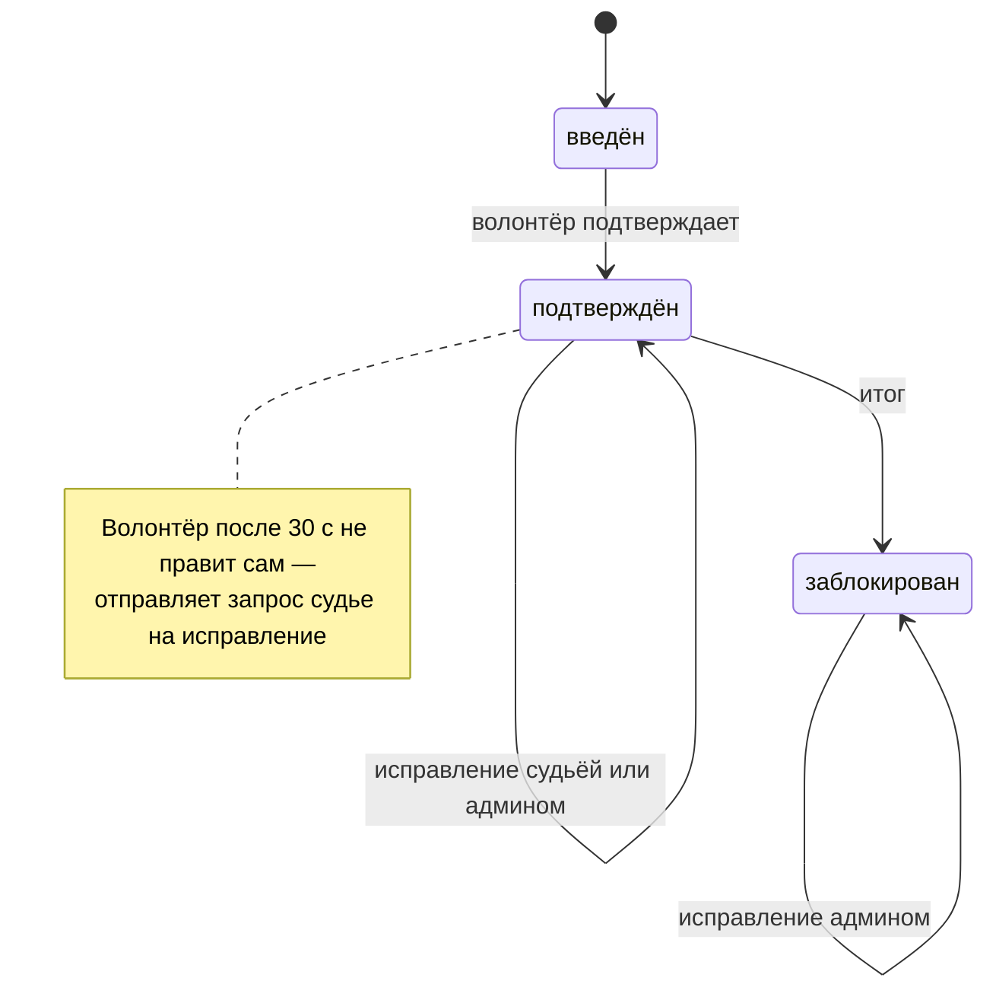
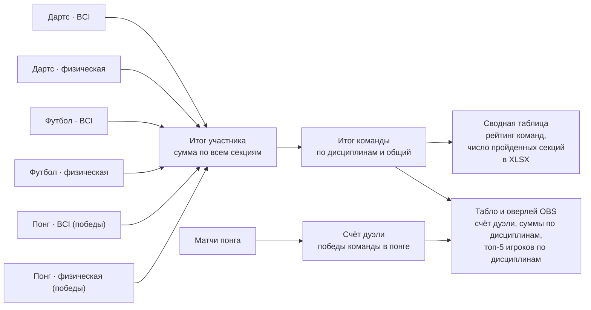

# Архитектура системы «Нейротлон»

Система проведения мероприятия в зале. Работает в локальной сети без интернета.
Сайт мероприятия — отдельный проект; итоговая таблица выкладывается на него после мероприятия вручную.

Схемы — источник истины. Меняются через PR вместе с кодом.

## 1. Физическая схема зала

- Без связи стенд копит результаты в локальном SQLite и досылает их позже.
- Вход участника: QR с вебки или ручной ввод ID → окно «Это я».
- Камера в браузере планшета работает только по HTTPS → локальный корневой сертификат на каждом планшете.

## 2. Сервисы на ПК админа

ПК админа — Windows с Docker Desktop (WSL2, Linux-контейнеры). Образы собираются заранее и переносятся на флешке (`docker save` / `docker load`), в зале интернета нет.

- Сервисы `server`, `web`, `backup`; описание — `deploy/docker-compose.yml`, порядок установки — `deploy/README.md`. Наружу открыты только порты 80 (редирект) и 443.
- SQLite в режиме WAL, `busy_timeout`, пишет один серверный процесс (один воркер uvicorn). База лежит в томе Docker (ext4 в WSL2), а не в папке Windows: WAL нужна общая память, которой нет у смонтированных папок Windows. Доступ через SQLAlchemy + Alembic — переход на PostgreSQL при росте сводится к смене строки подключения. Миграции применяются при старте `server`.
- Бэкап — SQLite Backup API раз в минуту в файл `neurotlon-ГГГГММДД-ЧЧММСС.db` (временный файл и переименование, хранится 120 последних) на внешний носитель или второй ноутбук. `neurotlon-server restore` заменяет базу копией и отказывается работать, пока база открыта сервером.
- `/health` проверяет подключение к базе (`SELECT 1`), по нему работают healthcheck-и контейнеров.
- Пересчёт таблиц и PDF бейджей идут внутри процесса сервера.
- После мероприятия: экспорт сводной таблицы в XLSX → публикация на сайте.

## 3. Устройство стенда

- BCI-мост — отдельный процесс на стенде; игра получает от него нормализованный сигнал по локальному сокету и не зависит от SDK датчиков. Для разработки без датчиков — эмуляция с клавиатуры.
- Понг: на одном ПК два Callibri (только ЭМГ), двое игроков.

## 4. Участник на стенде

Сервер ничего не назначает — только проверяет. Понг: сканируются оба игрока, результат — победитель и очки каждого.

## 5. Планшет волонтёра

- Аккаунт волонтёра привязан к одной секции; сессия не истекает в течение дня; суперпользователь может завершить сессии аккаунта.
- Формы: дартс и футбол — одно поле «Очки за секцию» от 0 до лимита (`max_points` из `GET /me/config`, целые числа, шаг 1); понг — победитель и очки каждого (лимитом не ограничены).

## 6. Жизненный цикл

## 7. Модель данных

- Итоги (участника, команды, рейтинг, исход дуэли) не хранятся — вычисляются из `SECTION_RESULT`.
- Журнал аудита только на добавление (триггеры запрещают UPDATE/DELETE).
- Время игры (`game_duration_s`) и физической дисциплины (`physical_duration_s`) меняют админ и судья в админке, в том числе с планшета. Лаунчер и планшет читают их перед каждой сессией; идущая сессия не обрывается; изменение пишется в журнал.

## 8. Статусы результата

## 9. Расчёт очков

- Правило очков секции — **заглушка** (`PlaceholderScoring`, решение 14), заменяется без изменения остального расчёта: дартс и футбол — очки секции как есть, но не больше лимита дисциплины (`discipline.max_section_points`, по умолчанию 10, 1…1000, настраивается; превышение — 422 `invalid_entries` при приёме и при правке судьёй, решение 27), понг — победы × очки за победу (`discipline.win_points`, по умолчанию 10, настраивается), «не прошёл» — 0 очков и секция не пройдена.
- Засчитывается единственный неаннулированный результат со статусом «подтверждён» или «заблокирован» по (участник, дисциплина, секция). Если таких два и больше — конфликт: секция не даёт ни очков, ни прохождения, пока судья, админ или волонтёр дисциплины не оставит один результат (`POST /conflicts/resolve`), остальные аннулируются (`voided_at`) с записью в аудит.
- Очки — целые числа (решение 28): `points` целое от 0 до 1000 в контракте, базе, расчёте, табло и XLSX; дробное значение при приёме и правке — 422 `invalid_entries`. Итоги — суммы целых, без округления.
- Итог команды — сумма по её участникам. Равенство: больше очков → больше пройденных секций → больше BCI-очков → больше физических; при полном равенстве ранг общий (решение судьи — позже).
- Шкалы и формулы секций — в настройках, без правки кода. Время не влияет. Методика подсчёта внутри игр — отдельный документ (в работе).

### Табло и оверлей

Снимок `GET /scoreboard` (и поток SSE) считается из результатов при каждом изменении и нигде не хранится.

- **Счёт дуэли** (`duel_score`) — число матчей понга, выигранных командой: один матч (одна сессия понга пары) — одно очко команде победителя. Считаются только засчитываемые результаты: матч, у которого результат аннулирован, не подтверждён или игрок в конфликте, не учитывается. Не зависит от очков и может измениться позже, поэтому это отдельная функция `duel_score` в `scoring.py`.
- **Шапка табло:** «название A [счёт дуэли] VS [счёт дуэли] название B» в цветах команд, таймера нет. Команды A и B — две первые по номеру.
- **Три полосы** — дартс, футбол, понг сверху вниз. Центр полосы: значок и «A vs B» — сумма очков команд в этой дисциплине (физическая + BCI). Слева топ-5 игроков команды A в этой дисциплине (место, имя или код, очки физической + BCI), справа топ-5 команды B зеркально. Порядок: очки по убыванию → больше пройденных секций дисциплины → меньший номер в команде. Игроки без засчитанного результата в дисциплине не показываются; игрок с конфликтом в секции дисциплины показывается первым с пометкой «нужно решение». Лимит — константа `TOP_LIMIT = 5` в `scoring.py`. Общего списка игроков с итогом на табло нет (он остаётся в XLSX).
- **Оверлей OBS** (`/overlay`, без входа, прозрачный фон): `?view=score` — названия, счёт дуэли и суммы по дисциплинам; `?view=full` — то же плюс по 3 лучших игрока в каждой полосе; `?scale=` — размер (0.25…4).
- Названия и цвета команд меняет админ (`PATCH /teams/{id}`, аудит); после жеребьёвки первые две команды — «Красные» и «Синие».
