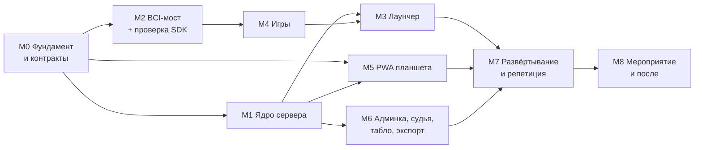

# Роадмап

Без дат: дата мероприятия не определена. Этапы идут по зависимостям; что не зависит друг от друга — параллельно.

## Статус

На 19.11.2026. «Код готов» — сделано и покрыто тестами в CI; «на железе» — проверка на реальных устройствах в зале.

| Этап | Статус | Что осталось |
|---|---|---|
| M0 Фундамент и контракты | готово | — |
| M1 Ядро сервера | готово | — |
| M2 BCI-мост | код готов | проверка на железе: BrainBit + Callibri, два Callibri на одном ПК (чек-лист в `bci-bridge/README.md`) |
| M3 Лаунчер | код готов | проверка на стенде: вебка, полноэкранная игра поверх лаунчера, реальная команда игры |
| M4 Игры | набор для интеграции готов | кит собран в Unity 6 (6000.6.9f1), пример проходит `neurotlon-game-check` для дартса и понга; дальше игры на Unity по одной; методика очков |
| M5 PWA планшета | код готов | проверка на Android и iPad: сертификат, камера, обрыв Wi-Fi |
| M6 Админка, судья, табло, экспорт | готово | — (бегущая строка не нужна; оверлей OBS сделан) |
| M7 Развёртывание и репетиция | код готов, репетиция 32/32 на Docker | репетиция отказов и прогон 6 пар в зале |
| M8 Мероприятие | — | — |

Открытые вопросы до методики: очки за сам факт прохождения, подсчёт неполной команды (`docs/decisions.md`).

## M0. Фундамент и контракты

- Структура монорепозитория: `server/`, `web/`, `launcher/`, `bci-bridge/`, `games/`, `shared/`, `deploy/`, `docs/`.
- `CLAUDE.md`, правила коммитов и PR, шаблон PR, линтеры, CI (тесты и проверки на каждый PR).
- Контракты в `shared/`: API сервера (OpenAPI), протокол BCI-мост → игра, формат результата лаунчер → сервер, формат ID и QR.

**Готово, когда:** контракты описаны и согласованы, CI зелёный на пустых пакетах.

## M1. Ядро сервера

- Модели и миграции (SQLite, WAL): участник, команда, дуэль, пара, станция, результат секции, журнал аудита, пользователь.
- Генерация ID и PDF бейджей с QR; check-in и категория.
- Жеребьёвка по концепции 4.0.0: воспроизводимость по зерну, протокол PDF.
- Приём результатов (идемпотентно по `session_id`), проверки (check-in, повтор дисциплины, «на другом стенде»).
- Расчёт итогов и рейтинга, SSE для табло; аутентификация и роли.

**Готово, когда:** тесты на жеребьёвку, приём результатов и расчёт проходят; табло обновляется ≤ 10 с.

## M2. BCI-мост и проверка SDK

- Подключение BrainBit и Callibri, калибровка, нормализованный сигнал 0…1 по локальному сокету.
- Эмуляция сигнала с клавиатуры для разработки без датчиков.
- Проверка на реальном железе: понг — два Callibri на одном ПК.

**Готово, когда:** на стенде видно живое значение сигнала от каждого датчика; эмулятор работает.

## M3. Лаунчер

- Вход станции по токену; QR вебкой и ручной ввод ID; окно «Это я».
- Запуск игры с ID участника, получение результата, отправка на сервер.
- Офлайн-буфер в SQLite, досылка, heartbeat.

**Готово, когда:** полный цикл «скан → игра → результат на табло» и досылка после отключения сети.

## M4. Игры

- Дартс, футбол, понг (двое игроков) на pygame-ce или Unity через протокол моста.
- Подсчёт очков по методике (до её утверждения — по настройкам).

**Набор для игр готов** (`games/README.md`): SDK `neurotlon_games.sdk` и шаблон игры для pygame-ce, кит `games/unity/NeurotlonKit` для Unity, проверка `neurotlon-game-check`. Запуск, датчики, калибровка, таймер, пауза при потере датчика и результат уже работают; Unity-кит собран в Unity 6000.6.9f1 без ошибок, пример `NeurotlonGame` проходит `neurotlon-game-check` для дартса и понга.

**Осталось:** геймплей каждой дисциплины, методика подсчёта очков, проверка на настоящих датчиках и первая сборка Unity-кита.

**Готово, когда:** каждая игра проходится с эмулятором и с датчиками, `neurotlon-game-check` проходит без `FAIL`, результат уходит в лаунчер.

## M5. PWA планшета

- Вход по логину и паролю, секция закреплена за аккаунтом, сессия на весь день.
- Скан QR камерой и ввод ID, формы секций, «не пройдено» с причиной, «Отменить» 30 с.
- Офлайн-очередь в IndexedDB; HTTPS с локальным сертификатом.

**Готово, когда:** ввод работает на Android и iPad, записи не теряются при обрыве Wi-Fi.

## M6. Админка, судья, табло, экспорт

- Админка: ID и бейджи, аккаунты волонтёров, станции и токены, настройки шкал.
- Судья: запросы на исправление, правки с причиной, блокировка итогов.
- Табло для большого экрана (сцены), экспорт сводной в XLSX.
- По решению: оверлей OBS, бегущая строка.

**Готово, когда:** исправление судьёй попадает в журнал и на табло; XLSX совпадает с табло.

## M7. Развёртывание и репетиция

- Установка на ПК админа одной командой, офлайн, с инструкцией: `deploy/` (Docker Compose, `install-admin.ps1`, пакет для флешки, `install-stand.ps1`, `deploy/README.md`).
- Бэкап раз в минуту (`neurotlon-server backup`), восстановление на ноутбуке (`neurotlon-server restore`).
- Инструмент репетиции `neurotlon-rehearsal`: прогон 20 участников по всем стендам, конфликт, отмена, исправление, табло, фиксация, XLSX.
- Репетиция отказов: отключение сети, перезапуск сервера, отказ планшета и стенда.
- Прогон не менее 6 пар по всем стендам без участия разработчика.

**Готово, когда:** все критерии репетиции пройдены.

## M8. Мероприятие и после

- Дежурство в зале.
- Экспорт итогов, публикация на сайте, архив.

## Что блокирует

- Документ с методикой подсчёта очков в играх → M4.
- Дата мероприятия → сроки этапов.
